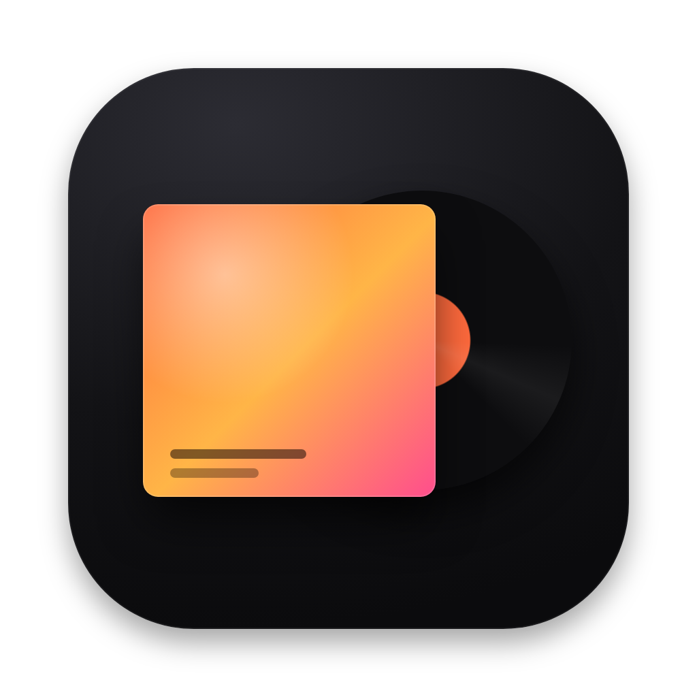
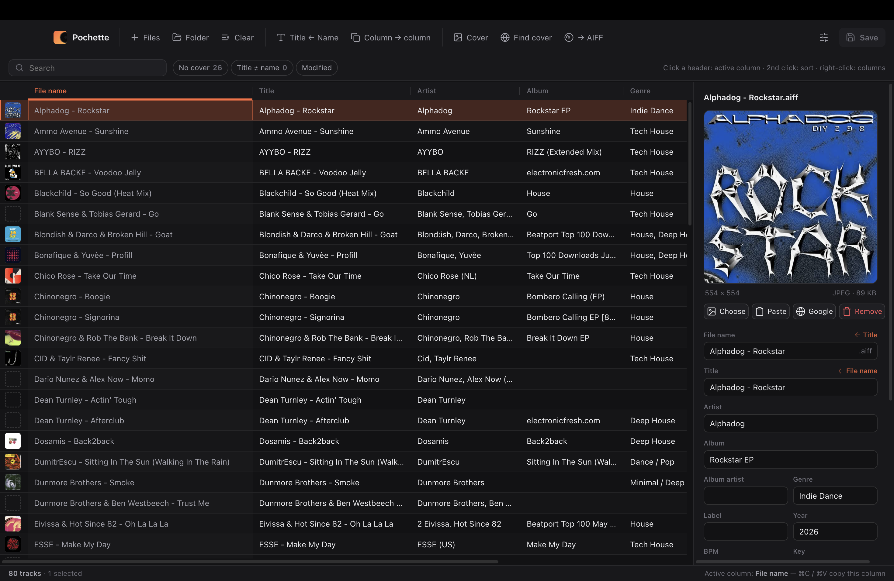

<div align="center">



# Pochette

**A tiny Mac app to edit the tags and covers of my tracks before they go into rekordbox.**


<br>



</div>

<br>

## Why

Fully vibe-coded, built in an afternoon to scratch my own itch: batch-rename titles, add covers that actually show up everywhere, and stop fighting with tag editors with a paywall.

## Download

Grab the latest `.dmg` from the [**Releases**](../../releases/latest) page — `arm64` for Apple Silicon Macs (M1 and later), `x64` for Intel Macs — open it and drag **Pochette** into **Applications**.

> [!NOTE]
> Pochette isn't notarized by Apple (it's a free side project), so macOS blocks it the first time:
> 1. Open Pochette — macOS says it can't verify the app. Click **Done**.
> 2. Go to **System Settings → Privacy & Security**, scroll down and click **Open Anyway**.
> 3. Confirm with your password. That's it, it opens normally from now on.
>
> Or in Terminal: `xattr -dr com.apple.quarantine /Applications/Pochette.app`

## Run it

```bash
npm install
npm start              # run in dev
npm run install-app    # build Pochette.app and copy it to /Applications
npm run release        # build dist/Pochette-<version>-arm64.dmg and -x64.dmg
npm test               # tag engine tests (needs ffmpeg)
```

## License

[MIT](LICENSE)
